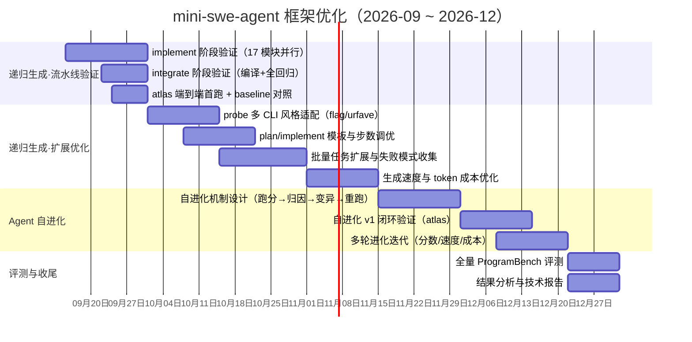

# mini-swe-agent 框架优化 · 甘特图

> **规划来源**：`harness/`（mini-swe-agent 改造层，现状见 `harness/change_log.md`）
> **两条主线**：递归生成（probe→plan→implement→integrate 流水线）、Agent 自进化（跑分→归因→变异→重跑闭环），先后衔接不并行
> **优化目标**：ProgramBench 任务分数、生成速度、token 成本
> **周期**：2026-09（W3 起）~ 2026-12，W1–W4 按自然月划分（W1=1–7 日，W2=8–14 日，W3=15–21 日，W4=月末）

> Mermaid 的时间轴是单行日期刻度，不支持“月份跨列合并 + W1–W4”双行表头；
> 需要精确表头（工作内容 / 9月 10月 11月 12月 / W3–W4 + W1–W4）的版本见同目录
> [gantt-harness-roadmap.pptx](gantt-harness-roadmap.pptx)（由 [gantt-planner](https://github.com/cinderzhan/gantt-planner) 渲染，
> 数据源 [gantt-harness-roadmap.json](gantt-harness-roadmap.json)，改一处重新 `node render_gantt.js` 即可再生成）。
